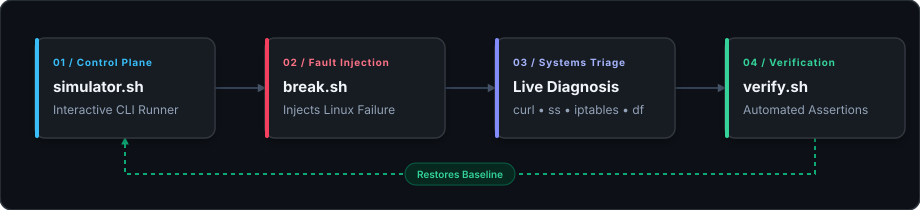

<h1 align="center">Production Incident Simulator</h1>

<p align="center">
  <a href="https://ubuntu.com/"></a>
  <a href="https://aws.amazon.com/linux/"></a>
  <a href="https://aws.amazon.com/ec2/"></a>
  <a href="https://www.gnu.org/software/bash/"></a>
  <a href="LICENSE"></a>
</p>

A hands-on tool to simulate, diagnose, and fix real-world Linux and AWS production incidents on **Ubuntu** and **Amazon Linux (AL2023 / AL2)**.

Instead of reading troubleshooting articles, this tool breaks a live EC2 system on purpose - dropping firewall packets, crashing daemons, or filling up disk storage, so you can troubleshoot the issue yourself in the terminal and verify your fix.

---

## How It Works

Every scenario follows a simple 4-step loop:

1. **`break.sh`** injects a specific infrastructure failure.
2. You investigate the symptom using standard Linux commands (`curl`, `ss`, `iptables`, `df`).
3. You apply your own fix manually.
4. **`verify.sh`** tests whether your fix actually restored the system. If stuck, **`fix.sh`** restores the baseline and **`runbook.md`** explains the root cause.

<p align="center">
  <picture>
    <source media="(prefers-color-scheme: dark)" srcset="./assets/architecture-dark.svg">
    <source media="(prefers-color-scheme: light)" srcset="./assets/architecture-light.svg">
    
  </picture>
</p>

---

## Scenarios

| # | Scenario | Symptom | Key Tools Tested |
| :---: | :--- | :--- | :--- |
| **01** | **[Silent Port Drop](./scenarios/01-net-port-drop/)** | `Connection timed out` on port 80 | `curl`, `ss -tuln`, `iptables -L -n -v` |
| **02** | **[Service Daemon Down](./scenarios/02-sys-service-down/)** | `Connection refused` (immediate reset) | `systemctl status`, `ss -tuln`, `journalctl -u` |
| **03** | **[Disk Space Full](./scenarios/03-disk-space-full/)** | `No space left on device` (HTTP 500) | `df -h`, `du -sh /*`, `truncate -s 0` |
| *04* | *Inode Exhaustion (Next)* | `df -h` shows space, but writes fail | `df -i`, `find . -xdev -type f` |
| *05* | *Unlinked Open Files (Next)* | Disk full even after `rm` deletion | `lsof +L1`, `/proc/$PID/fd` |
| *06* | *Silent OOM-Kill (Next)* | Process disappears without logs | `dmesg -T \| grep oom`, `journalctl -k` |

> **Note on safety:** Scenarios that fill disk space run on an isolated 50MB loopback virtual mount (`/mnt/app-storage`). Your EC2 root disk and SSH session are never at risk.

---

## Repository Structure

```text
production-incident-simulator/
├── setup-ec2.sh                      # 1-click bootstrap (installs Nginx, curl, net-tools, iptables)
├── simulator.sh                      # Interactive master CLI menu
│
├── scenarios/
│   ├── 01-net-port-drop/             # Scenario 01: Firewall Drop (Connection Timeout)
│   │   ├── break.sh                  # Drops incoming port 80 traffic
│   │   ├── verify.sh                 # Tests if port 80 returns HTTP 200
│   │   ├── fix.sh                    # Removes the drop rule
│   │   └── runbook.md                # Triage steps and root cause
│   │
│   ├── 02-sys-service-down/          # Scenario 02: Daemon Down (Connection Refused)
│   │   ├── break.sh                  # Stops Nginx service
│   │   ├── verify.sh                 # Checks if Nginx is running and responding
│   │   ├── fix.sh                    # Starts and enables Nginx
│   │   └── runbook.md                # Explains Connection Refused vs Timed Out
│   │
│   └── 03-disk-space-full/           # Scenario 03: 100% Full Partition
│       ├── break.sh                  # Mounts 50MB virtual disk and fills it
│       ├── verify.sh                 # Asserts free disk space and write access
│       ├── fix.sh                    # Truncates runaway log file to 0 bytes
│       └── runbook.md                # Storage triage and truncate vs rm
│
└── README.md
```

---

## Quickstart (Amazon Linux / Ubuntu / EC2)

```bash
# 1. Clone repository
git clone https://github.com/dhananjaybhusari/production-incident-simulator.git
cd production-incident-simulator

# 2. Bootstrap environment (Installs Nginx and network diagnostic tools)
sudo bash setup-ec2.sh

# 3. Launch the interactive menu
sudo ./simulator.sh
```

---

## How to Practice

When you run `sudo ./simulator.sh`, an interactive menu appears:

```text
==============================================================
       [SRE] Production Incident Simulator & War Room         
==============================================================
 Available Scenarios:
   [1] Scenario 01: Silent Port Drop       (Connection Timeout)
   [2] Scenario 02: Service Daemon Down    (Connection Refused)
   [3] Scenario 03: Disk Space Exhaustion  (100% Full / No Space)

 Actions:
   [B] Break / Inject Fault
   [V] Verify Resolution (Test your fix)
   [F] Fix / Apply Auto-Remediation
   [Q] Quit
==============================================================
Select an action [B/V/F/Q]: 
```

1. Press **`B`** and choose a scenario (`1-3`) to break the server.
2. Check the error symptom in your terminal.
3. Diagnose and fix the issue manually using Linux commands.
4. Press **`V`** to run the automated check and confirm if your fix worked.
5. If you're stuck, check the scenario's `runbook.md` or press **`F`** to auto-restore.

---

## License
MIT
